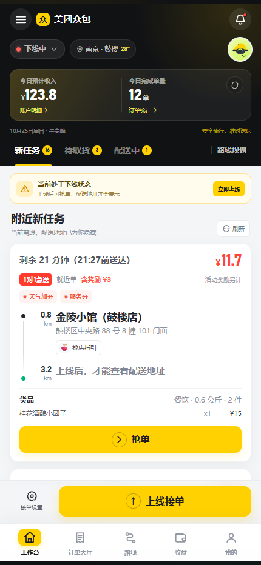
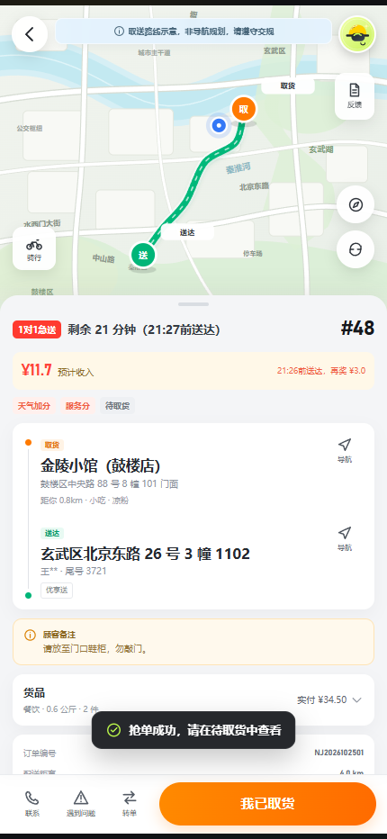
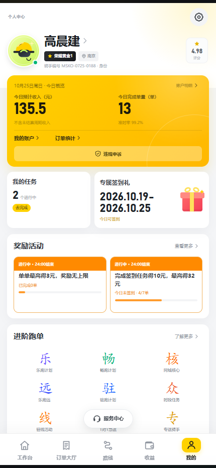
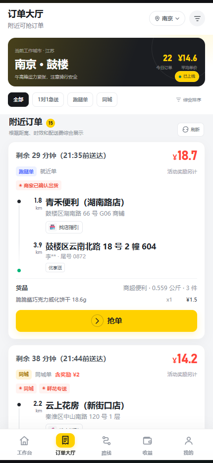
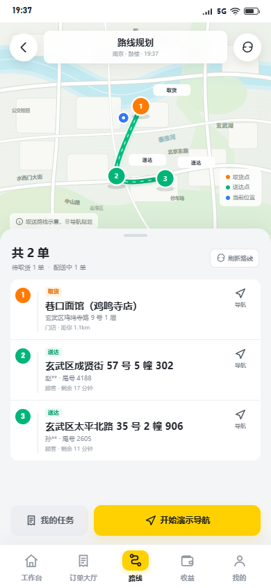
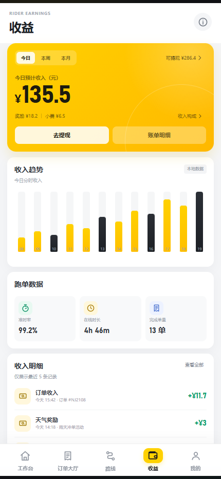

# 狗团众包

> **重要声明**
>
> 本项目是一个独立开发的 H5 界面与交互学习样例，**与狗团官方无关**。
> 不包含原 APK 的源代码、图片、字体、地图、图标、音频或任何私有资源；不接入真实账号、真实订单、真实定位、支付、推送或反作弊系统。
> 页面中的商家、顾客、地址、电话尾号、订单和收益全部为虚构数据。
> 本项目不得用于冒充官方应用、真实接单、商业运营或任何违法违规用途。

参考对象是用户提供的公开可见界面截图与 APK 基础元数据。设计目标是高保真还原信息层级、布局节奏、状态反馈与骑手工作流，而不是复制受版权保护的实现或素材。



---

## 1. 项目概览

| 项目     | 内容                                               |
| -------- | -------------------------------------------------- |
| 技术栈   | Vue 3 + Vue Router + Vite + 原生 CSS + 本地 JSON   |
| 运行方式 | 纯前端，不依赖后端接口                             |
| 城市     | 南京、合肥、杭州（浙江）                           |
| 订单     | 12 条虚构订单，覆盖新任务、待取货、配送中、已完成  |
| 主色     | 狗团黄 `#FFD100`，黑色工作台，红色价格，绿色送达   |
| 适配     | 360 / 390 / 430 宽度移动端，以及桌面端居中手机画框 |
| 状态存储 | `localStorage`，可随时在设置中重置                 |

### 页面预览

| 工作台                               | 订单详情                                      | 个人中心                        |
| ------------------------------------ | --------------------------------------------- | ------------------------------- |
|  |  |  |

| 订单大厅                     | 路线规划                              | 收益                             |
| ---------------------------- | ------------------------------------- | -------------------------------- |
|  |  |  |

---

## 2. 快速启动

```bash
cd D:\crack\meituan\code
npm install
npm run dev
```

浏览器访问：

```text
http://127.0.0.1:5173/
```

生产构建：

```bash
npm run build
npm run preview
```

构建产物位于 `dist/`，路由使用 Hash 模式，可直接部署到静态服务器或打开构建后的 `index.html`。

---

## 3. 页面与路由

| 路由                         | 页面          | 说明                                             |
| ---------------------------- | ------------- | ------------------------------------------------ |
| `/home`                      | 首页 / 工作台 | 上线状态、今日概览、新任务 / 待取货 / 配送中切换 |
| `/hall`                      | 订单大厅      | 类型筛选、排序、距离 / 最低价格筛选、抢单        |
| `/tasks`                     | 我的任务      | 全部 / 待取货 / 配送中 / 已完成 / 已取消         |
| `/orders/:id`                | 订单详情      | 地图、路线、货品、顾客备注、状态动作             |
| `/orders/:id/result/:result` | 订单结果      | 已送达 / 已取消、顾客评价、收入明细              |
| `/route`                     | 路线规划      | 多单路线、取送点、导航                           |
| `/earnings`                  | 收益          | 今日 / 本周 / 本月、趋势图、跑单数据、明细       |
| `/profile`                   | 个人中心      | 收入概览、任务、奖励、进阶计划、服务中心         |
| `/settings`                  | 设置          | 城市、辅助开关、隐私、反馈、重置、退出           |
| 其他                         | 404 重定向    | 自动回到 `/home`                                 |

底部导航为需求中指定的 H5 导航层：

1. 工作台
2. 订单大厅
3. 路线
4. 收益
5. 我的

> 原始截图主要呈现顶部状态标签和场景化底部操作条，没有显示固定五栏底部导航。为了满足本项目的“底部导航”要求，H5 增加了五栏导航，同时保留原界面的“新任务 / 待取货 / 配送中 / 路线规划”顶部标签与订单详情底部操作条。

---

## 4. 已实现交互

### 工作状态

- 下线时隐藏顾客完整地址，订单卡显示“上线后，才能查看配送地址”。
- 点击“上线接单 / 下线休息”切换工作状态。
- 离线点击“抢单”会弹出“当前为下线状态”，确认后自动上线并抢单。
- 今日收入、完成单量随送达订单累计。

### 订单状态机

```text
待抢单 available
   │ 抢单（必须在线）
   ▼
待取货 accepted
   │ 我已取货
   ▼
配送中 picked
   │ 确认送达
   ▼
已完成 delivered

待取货 / 配送中 / 待抢单 ── 取消 ──► 已取消 cancelled
待取货 ── 转单 ──► 回到待抢单池
```

- 抢单、取货、送达均使用本地状态，刷新页面后保留。
- 转单后订单回到订单大厅。
- 取消订单后进入“已取消”结果页，并在“我的任务”中可查。
- 所有“联系”“导航”“提现”“客服”入口均为明确的占位，不调用真实能力。

### 筛选与弹窗

- 订单大厅支持按订单类型、价格、取货距离筛选，支持综合 / 价格 / 距离 / 时效排序。
- 筛选底部弹层显示动态结果数量。
- 抢单确认、上线提示、转单、取消、重置、退出、支付说明、隐私政策、关于等均为可操作弹窗 / 底部弹层。
- 工作台消息中心、城市切换、更多服务、问题反馈、联系相关方等都有状态反馈。

### 页面导航

- 底部导航连接五个主页面。
- 订单卡点击进入详情；详情主按钮串联取货、送达和结果页。
- 个人中心可进入收益、任务、设置。
- 路线页可直接跳转具体订单或“我的任务”。

---

## 5. 目录结构

```text
code/
├─ public/
│  └─ brand.svg                 # 原创品牌图形
├─ src/
│  ├─ components/
│  │  ├─ layout/                # AppHeader / BottomNav / StatusBar
│  │  ├─ map/                   # SimulatedMap 本地 SVG 地图
│  │  ├─ order/                 # OrderCard
│  │  └─ ui/                    # Modal / Sheet / Toast / Icon / Switch 等
│  ├─ data/
│  │  ├─ cities.json            # 南京 / 合肥 / 杭州
│  │  ├─ orders.json            # 南京 22 条、合肥 12 条、杭州 12 条（共 46 条）
│  │  └─ profile.json           # 骑手、收益、奖励、任务
│  ├─ router/index.js
│  ├─ stores/appStore.js        # 在线、订单状态、持久化、Toast
│  ├─ styles/
│  │  ├─ tokens.css             # 颜色、字号、圆角、阴影
│  │  └─ base.css               # 重置、通用按钮、页面框架
│  ├─ utils/format.js
│  ├─ views/                    # 9 个页面级 SFC
│  ├─ App.vue
│  └─ main.js
├─ scripts/                     # Playwright UI 测试与截图脚本
├─ screenshots/                 # 回归测试截图
├─ docs/
│  ├─ UI-ANALYSIS.md            # 页面清单、导航关系、视觉规范
│  └─ TEST-REPORT.md            # 测试记录与覆盖范围
├─ index.html
├─ package.json
└─ vite.config.js
```

### 公共组件

| 组件               | 作用                                    |
| ------------------ | --------------------------------------- |
| `AppHeader`        | 白 / 黑主题、返回、标题、右侧操作插槽   |
| `BottomNav`        | 五栏主导航与激活态                      |
| `StatusBar`        | 时间、5G、信号、电池                    |
| `OrderCard`        | 订单摘要、取送路线、货品、状态、主操作  |
| `SimulatedMap`     | 纯 SVG 地图、道路、河流、路线、取送标记 |
| `AppModal`         | 居中 / 底部适配的确认弹窗               |
| `BottomSheet`      | 城市、筛选、消息、反馈等底部弹层        |
| `SegmentedControl` | 通用分段选择控件                        |
| `SettingsRow`      | 设置行                                  |
| `ToggleSwitch`     | 可访问的开关                            |
| `ToastHost`        | 全局轻提示                              |
| `RiderAvatar`      | 原创骑手头像                            |
| `EmptyState`       | 空状态                                  |

---

## 6. 本地数据

- `orders.json`：南京 22 条、合肥 12 条、杭州 12 条（共 46 条）虚构订单，每单包含城市、类型、价格、奖励、时限、商家、虚构顾客、地址、货品、路线坐标。
- `cities.json`：南京 / 合肥 / 杭州（浙江）及对应区域、中心点、天气提示。
- `profile.json`：虚构骑手“高晨建”、等级、评分、收益、任务、奖励、进阶计划、消息。
- 送达时限与奖励时间以本次打开的时间为基准动态生成，并由 `appStore.js` 每 30 秒刷新一次，避免出现静态时间穿帮。
- 订单状态和设置由 `appStore.js` 持久化到浏览器 `localStorage`。

重置方式：

1. 进入“我的 → 设置 → 重置数据”；或
2. 浏览器开发者工具清除该页面 `localStorage`。

---

## 7. 视觉规范

| 设计变量 | 值                                                |
| -------- | ------------------------------------------------- |
| 品牌黄   | `#FFD100`                                         |
| 工作台黑 | `#111214` / `#17191D`                             |
| 页面底色 | `#F4F5F7`                                         |
| 卡片白   | `#FFFFFF`                                         |
| 价格红   | `#FF453A`                                         |
| 取货橙   | `#FF7A00`                                         |
| 送达绿   | `#00B578`                                         |
| 主圆角   | 10 / 14 / 18 / 24 px                              |
| 数字字体 | DIN Alternate / Bahnschrift 回退                  |
| 正文字体 | PingFang SC / HarmonyOS Sans SC / Microsoft YaHei |
| 动效     | 150–300ms，`prefers-reduced-motion` 下关闭        |

更完整的页面结构、截图依据与导航关系见 [UI-ANALYSIS.md](docs/UI-ANALYSIS.md)。

---

## 8. 测试

先启动开发服务器，再运行：

```bash
npm run dev

# 完整主流程 + 截图
npm run test:ui

# 交互断言
npm run test:ui:interactions

# 多页面 × 多视口布局审计
npm run test:ui:audit
```

测试脚本默认使用：

```text
C:\Program Files\Google\Chrome\Application\chrome.exe
```

如果 Chrome 安装在其他位置，请设置：

```powershell
$env:CHROME_PATH = "D:\path\to\chrome.exe"
```

覆盖内容：

- 10 个路由在 360 / 390 / 1440 宽度下的横向溢出与运行时错误。
- 上线、抢单、取货、送达、结果页、筛单、转单、取消、签到、设置持久化、重置等流程。
- 浏览器控制台错误与页面异常。
- 390×844 与桌面手机画框截图。

详见 [TEST-REPORT.md](docs/TEST-REPORT.md)。

---

## 9. 与原始 APK 的边界

已完成：

- 读取用户提供 APK 的 AndroidManifest 与资源清单基础元数据：应用名 `狗团众包`、包名、版本、启动 Activity、SDK 范围。
- 参考用户提供的公开界面截图，分析页面层级、状态标签、订单卡信息结构和视觉规范。
- 独立编写全部 Vue、CSS、SVG 和本地数据。

未做且不会做：

- 不复制 APK 的 DEX / Java / Kotlin / 资源文件、图片、字体、音频、地图瓦片或私有接口。
- 不接入狗团真实业务接口、登录、鉴权、反作弊、支付、定位、推送。
- 不操作真实骑手账号、真实订单，不绕过任何平台限制。
- 不伪造官方身份。应用内多处标注“学习 / 与狗团官方无关”。

---

## 10. 已知限制

- 地图为纯 SVG 示意图，不提供真实道路、实时定位或导航。
- 顾客电话、客服、提现、支付、推送均为弹层，不执行真实动作。
- 本项目没有真实账号体系和后端；刷新后保留的是本地状态，不代表服务器状态。
- 未在物理手机上做最终验收；已使用 Chrome 150 的 360 / 390 / 430 / 1440 视口完成测试。真机 WebView / iOS Safari 的字体与安全区表现仍建议再验收一次。
- 未使用原 APK 的官方字体，数字与中文字体使用系统回退，因此个别字重与原始截图存在差异。

---

## 11. 许可与使用

本仓库代码仅用于界面与前端交互的学习、和交流。不得删除或隐藏“学习”“与狗团官方无关”等标识，不得用于真实配送业务或冒充官方应用。


