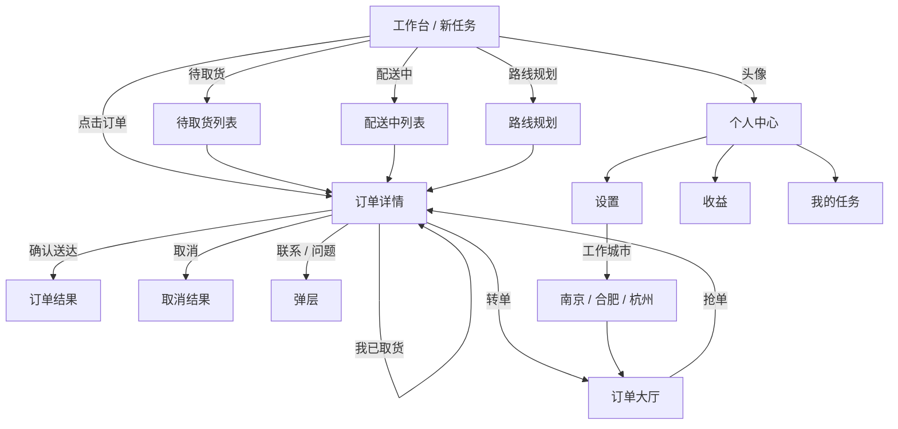

# 美团众包公开界面分析

> 本文是基于用户提供的公开可见截图、以及 APK 基础元数据所做的界面结构分析，用于独立 H5 学习的设计依据。
> 未反编译 DEX，未复制源代码或素材，也未复现任何真实业务接口。

---

## 1. 目标身份

通过 `AndroidManifest.xml` 与资源清单读取到的基础事实：

| 字段              | 观察值                                               |
| ----------------- | ---------------------------------------------------- |
| 应用名            | 美团众包                                             |
| 包名              | `com.sankuai.meituan.dispatch.crowdsource`           |
| versionName       | `13.9.5.8394`                                        |
| versionCode       | `2850`                                               |
| 启动 Activity     | `com.meituan.banma.main.activity.MainSplashActivity` |
| minSdkVersion     | 21                                                   |
| targetSdkVersion  | 30                                                   |
| compileSdkVersion | 30                                                   |
| 原生架构          | `armeabi`                                            |
| 资源规模          | 约 7000+ 资源条目、338 个 assets、84 个 native 库    |

这些信息仅用于确认目标身份与产品阶段；没有据此复制任何实现。

---

## 2. 截图页面清单

| 原始界面                | 用户截图     | 关键结构                                                                                          |
| ----------------------- | ------------ | ------------------------------------------------------------------------------------------------- |
| 工作台 · 新任务（下线） | `106`、`107` | 黑色顶部、在线状态、顶部状态标签、新任务卡片、抢单 CTA、底部上线按钮                              |
| 订单详情 · 抢单态       | `101`、`105` | 地图、路线、取 / 送标记、倒计时、配送费、标签、商家、顾客地址、货品、抢单 CTA                     |
| 订单详情 · 待取货       | `102`        | 地图 + 底部信息面板、剩余时间、订单号、商家 / 顾客、顾客备注、货品、上报到店 / 联系 / 问题 / 转单 |
| 订单详情 · 配送中       | `103`        | 取送路线、取 / 送标记、已取货按钮、订单卡片                                                       |
| 订单结果 · 已当面签收   | `104`        | 大标题、状态说明、订单路线、顾客满意度、货品、订单收入、联系 / 问题                               |
| 订单结果 · 已取消       | `110`        | 取消标题、协商说明、隐藏地址、满意度、订单时间和状态节点                                          |
| 路线规划                | `109`        | 地图多编号点、取货 / 送达混合列表、剩余时间、导航按钮                                             |
| 个人中心                | `108`        | 头像与等级、黄色收入卡、违规申诉、任务 / 签到、奖励活动、进阶跑单、服务中心                       |
| 设置                    | `100`        | 个人信息、配送辅助、隐私、支付、反馈、协议、注销、退出登录                                        |
| 导航地图                | `105`        | 地图为主视觉，路线、起终点、费用、时效、接单 CTA                                                  |

### 观察到的信息层级

1. **状态先于内容**：倒计时、价格、状态标签在订单卡和详情页最上方。
2. **取送关系可视化**：纵向点线 + 距离列 + 两段地址，是订单卡和详情页的核心结构。
3. **动作靠近场景**：抢单按钮位于卡片 / 详情底部，取货、送达、转单、联系、问题以底部 action bar 形式出现。
4. **身份与收益并列**：个人中心用黄色大卡承接“今日预计收入 / 今日完成单量”，与头像等级形成工作台身份区。
5. **奖励与任务卡片化**：橙边活动卡、进度条、数字徽标构成高频视觉刺激。

---

## 3. 导航关系

从截图与界面语义整理出的主路径：



### 原始界面的顶部标签

- 新任务
- 待取货
- 配送中
- 路线规划

### 原始界面的场景化底部动作

- 抢单（工作台订单卡）
- 1 对 1 急送 / 我已取货 / 确认送达
- 联系 / 遇到问题 / 转单 / 上报到店
- 上线 / 下线

### H5 的导航增补

由于本项目明确要求“底部导航”，H5 在保留顶部状态标签与场景化底部动作的同时，增加了五栏固定导航：

`工作台 · 订单大厅 · 路线 · 收益 · 我的`

这属于产品需求层面的增补，并非对原 APK 底部导航的事实描述。

---

## 4. 页面结构拆解

### 4.1 工作台

```
状态栏
黑色 Header
  ├─ 菜单 / 品牌 / 学习徽标 / 消息
  ├─ 上线状态胶囊 / 城市 / 天气 / 头像
  ├─ 今日收入 + 完成单量
  └─ 新任务 / 待取货 / 配送中 / 路线规划
浅灰内容区
  ├─ 下线提示条
  ├─ 附近新任务标题 + 刷新
  ├─ 订单卡 × N
  └─ 免责声明
吸底操作区
  └─ 接单设置 / 上线接单
底部导航
```

### 4.2 订单卡

- 倒计时 / 订单状态 / 价格
- 订单类型、奖励、活动说明
- 标签（天气、服务分、商家已出货等）
- 取货商家 + 距离 + 地址 + 找店指引
- 送达地址 + 距离 + 脱敏顾客 + 配送标签
- 货品摘要 + 首件商品 + 数量 / 价格
- 抢单 / 去取货 / 去送达 CTA

### 4.3 订单详情

- 全幅地图 + 返回 / 提示 / 头像 / 反馈 / 定位 / 刷新 / 骑行
- 地图下方可滚动白色面板
  - 状态 / 倒计时 / 订单号 / 配送费 / 奖励
  - 订单状态进度（抢单 → 取货 → 送达）
  - 取送地址与导航
  - 顾客备注
  - 货品折叠列表
  - 订单编号、距离、要求送达、收入说明
- 底部动作条：联系 / 遇到问题 / 转单 / 主状态按钮

### 4.4 订单结果

- 大状态图标 + 标题 + 副标题 + 状态徽标
- 商家 → 顾客地址摘要
- 顾客满意度（不满意 / 满意）
- 货品明细
- 订单收入拆分
- 订单时间轴
- 客服 / 返回工作台

### 4.5 个人中心

- 头像、姓名、等级、评分、工作城市
- 黄色今日收入 / 完成单量卡
- 违规申诉
- 我的任务 / 专属签到礼
- 奖励活动两张卡
- 进阶跑单九宫格
- 工作必备
- 服务中心浮动按钮

### 4.6 设置

- 身份卡（登录 / 呼叫手机号脱敏）
- 配送辅助开关
- 工作城市
- 隐私、缓存
- 支付、反馈、协议、隐私、关于
- 重置数据
- 注销类入口（说明）
- 退出登录

---

## 5. 视觉规范

| 令牌     | 取值                  | 应用                         |
| -------- | --------------------- | ---------------------------- |
| 品牌黄   | `#FFD100`             | 主 CTA、收入卡、激活态、徽标 |
| 深黑     | `#111214` / `#17191D` | 工作台 Header、深色按钮      |
| 页面底色 | `#F4F5F7`             | 全站内容背景                 |
| 卡片     | `#FFFFFF`             | 订单 / 设置 / 收入模块       |
| 主文字   | `#17191D` / `#252A31` | 标题、金额                   |
| 次文字   | `#7F8691`             | 说明、地址                   |
| 弱文字   | `#9AA1AB`             | 辅助信息                     |
| 价格红   | `#FF453A`             | 配送费、奖励、收入           |
| 取货橙   | `#FF7A00`             | 取货标记、橙色主按钮         |
| 送达绿   | `#00B578`             | 送达标记、成功、绿色按钮     |
| 分割线   | `#EDEFF2`             | 卡片内分隔                   |

### 尺寸与排版

- 页面左右安全边距：14–16px
- 卡片圆角：12–15px；底部弹层：24px
- 底部导航高度：约 62px + safe-area
- 订单标题：16–18px / 700–800
- 价格数字：26–48px / 800，使用窄体数字字体
- 辅助文案：8–11px
- 触点高度：主 CTA ≥ 44px

### 图标与图像

- 图标统一使用本地内联 SVG（线性、1.9 描边、圆角端点）。
- 地图使用纯 SVG 绘制道路、河流、公园、街区、路线和标记。
- 头像为原创 SVG 骑手图形。
- 品牌图形为原创黄色“众”字块，不使用官方 Logo 或 APK 图标。
- 不含 APK 内的图片、Lottie、字体、音频、地图瓦片或第三方素材。

---

## 6. 状态与交互映射

| 原始场景 | H5 行为                                    |
| -------- | ------------------------------------------ |
| 下线状态 | 顾客地址隐藏；抢单需先上线                 |
| 上线     | 状态胶囊、底部按钮、工作台提示同步变化     |
| 抢单     | 弹出确认；成功后进入待取货，订单从大厅移除 |
| 我已取货 | 状态变为配送中；进度条点亮；主按钮变绿     |
| 确认送达 | 收入累计、完成单量 +1、进入结果页          |
| 转单     | 确认后恢复待抢单，返回工作台               |
| 取消     | 确认后进入取消结果页，任务中心可查         |
| 筛选     | 类型 / 距离 / 最低价格 / 排序均实时计算    |
| 切换城市 | 南京 / 合肥 / 杭州订单与地图标签同步       |
| 结果评价 | 不满意 / 满意可选中并给出提示              |
| 签到     | 当前日期持久化，刷新后仍为“今日已签到”     |

---

## 7. 独立实现说明

- 仅使用 APK 的元数据（包名、版本、应用名、启动 Activity）确认目标。
- 没有使用 JADX 或反编译源码；实现依据是公开可见截图与交互逻辑。
- 没有复制原始截图到产品中；截图仅作为分析依据保存在用户目录，不进入产品资源。
- 所有商家名、顾客、地址、尾号、金额、活动名均为虚构。
- 身份、收入、奖励、订单状态均在本地生成。
- 页面明确标注“学习”“与美团官方无关”“不可提现”等边界。

---

## 8. 设计取舍

1. **保留黑黄骑手视觉**：黑色工作台、黄色 CTA、红色价格是品类识别核心。
2. **保留顶部状态标签**：这是骑手工作流的核心；不使用原始图片素材。
3. **增加固定底部导航**：满足需求并让五个主页面可直接到达。
4. **使用 SVG 地图**：避免接入真实地图 SDK、API Key 与定位权限，同时保证离线可运行。
5. **用状态机驱动界面**：同一订单卡在不同状态下显示不同 CTA，避免页面复制。
6. **用 localStorage 持久化**：让状态在刷新后保留，同时提供一键重置。
